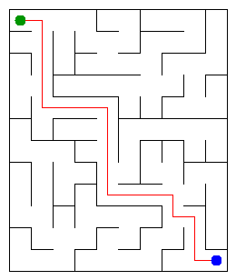

# Assignment 3. Maze Escape

Student ID: 251764
Name: Balakhazy Askar
Group: SE-2532
Maze size 12 10 

This file is the report. How to start: `START_HERE.md`. The task: `docs/Assignment3.pdf`.

## Program output

The 13 lines my program prints on my data (`java -cp out Main`):

    Broken: 119
    Kept: 99
    Last broken wall: 178
    MST cost: 37116
    Heaviest broken wall: 858
    Path length: 20
    DFS visited: 77
    Dead ends: 33
    Zones: 120
    Largest zone: 1
    Is DAG: 1
    Flow stages: 15
    Fastest route cost: 22

My maze:

## Questions

Mission 0. What do find and union do, and what makes them fast in your code?

find(x) goes up from x to the root of its group (the root points to itself). union(a, b) finds the roots of a and b; if they are the same, it returns false, otherwise it hangs the smaller tree under the bigger one and returns true. Two tricks keep the trees flat: union by size and path compression (find hangs every cell it passed directly on the root). Because of this, find and union are almost O(1).

Mission 1. Why is Broken always R*C - 1, and Kept always (R-1)*(C-1)?

At the start every cell is its own group, so there are R*C groups. A wall is broken only when union joins two different groups, so every break reduces the number of groups by exactly 1. All cells end up in one group (the maze is connected), so there are exactly R*C - 1 breaks. The total number of walls is R*(C-1) + C*(R-1), so Kept = R*(C-1) + C*(R-1) - (R*C - 1) = R*C - R - C + 1 = (R-1)*(C-1).

Mission 2. My MST cost from Kruskal and from Prim, and why they are equal:

Both give 37116. Kruskal takes the cheapest walls that join different groups. Prim grows one maze from cell 0 and always takes the cheapest wall that leads to a new cell. All costs are different, so the cheapest maze is only one, and both greedy algorithms find it.

Mission 3. Why is there exactly one path between two cells? How did you avoid a stack overflow on a huge maze?

The maze has R*C cells, R*C - 1 open walls, and it is connected. A connected graph without cycles is a tree (we never break a wall between cells that are already connected, so no cycle appears). In a tree there is exactly one path between two cells. My DFS has no recursion: I keep my own stack in arrays (the cells of the current path and the next direction to try for each of them), so the size of the maze does not matter for the call stack. I tested it on 1000 x 1000.

Mission 4. Why does the second pass of Kosaraju go on the reversed graph? Why do the slides have no cycle exactly when Zones equals the number of cells?

The cell that finishes last in the first pass is in a zone that has no slides coming into it from other zones. In the reversed graph the DFS from it can only reach cells that can reach it, so it stays inside its own zone. On the normal graph the DFS would leak into the other zones. A cycle means two different cells can reach each other, so they are in one zone and Zones < number of cells. If there is no cycle, no two cells can reach each other, so every cell is a zone of its own and Zones = number of cells.

Mission 5. Why is it enough to go through the zones in the order of their numbers? What does this pass cost?

The zones are numbered in topological order: every slide between zones goes from a smaller number to a larger one. When I reach a zone, all slides that enter it were already processed, so its longest chain and its cheapest cost are final, and I do not need a priority queue. Every zone and every slide is looked at once, so the cost is O(n + m).

## AI use

AI was used to clarify the assignment requirements, brainstorm possible approaches before selecting the most suitable logic, and provide guidance during implementation. It helped me identify mistakes in my code, understand logical issues, and improve my approach by providing explanations and suggestions for my project

## Timing (Mission 7)

Milliseconds, 5 runs each, from `java -cp out Bench` (average).

| maze | Kruskal | Prim |
|---|---|---|
| 100 x 100 | 39 | 46 |
| 300 x 300 | 158 | 274 |
| 1000 x 1000 | 1882 | 5429 |

The number of cells grows 9 times from 100x100 to 300x300 and 100 times from 100x100 to 1000x1000. The time of both algorithms grows a bit faster than the number of cells, which fits O(m log m). Prim is slower on the big maze because of the priority queue (it holds up to 2m walls). The first runs are slower because the JVM is still warming up.

## Complexity

n is the number of cells, m the number of walls (or slides).

| algorithm | time | space | assumptions |
|---|---|---|---|
| DSU find and union | almost O(1) (O(alpha(n)) amortized) | O(n) | union by size + path compression |
| Kruskal | O(m log m) | O(n + m) | sorting the walls is the main cost |
| Prim | O(m log m) | O(n + m) | priority queue with walls, each wall can be added twice |
| DFS | O(n) | O(n) | the maze is a tree, so m = n - 1 |
| Kosaraju | O(n + m) | O(n + m) | two DFS passes, adjacency lists |
| Route in the zone graph | O(n + m) | O(n + m) | zones are in topological order, no priority queue |

